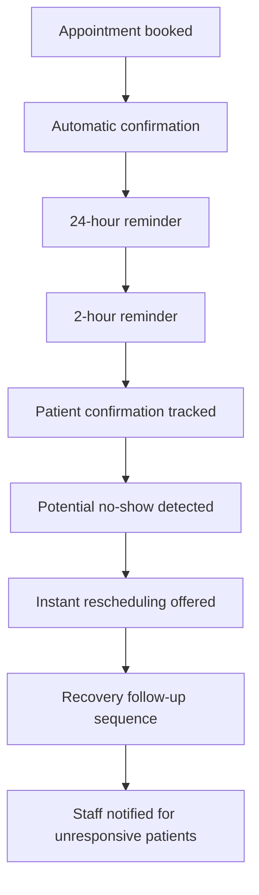

# Smart Patient Engagement & Appointment Recovery System

An n8n workflow that helps clinics reduce missed appointments, improve patient engagement and recover lost bookings. It confirms appointments, sends reminders, tracks responses, detects likely no-shows and offers instant rescheduling, so staff spend less time making reminder calls.

---

## The Problem

Missed appointments are one of the most common operational challenges for healthcare providers:

- Patients forget their appointments
- High no-show rates
- Empty appointment slots and lost revenue
- Administrative staff spend hours making reminder calls
- Patients who miss an appointment often never return for follow-up care

## The Solution

This workflow automates patient engagement before and after appointments to reduce no-shows and increase patient retention.

It automatically:

- Confirms appointments
- Sends reminder notifications
- Tracks patient confirmations
- Detects potential no-shows
- Offers instant rescheduling
- Launches recovery workflows for missed appointments

## Workflow Overview

## Key Features

- Automated appointment confirmations
- 24-hour appointment reminders
- 2-hour appointment reminders
- Patient confirmation tracking
- Automated rescheduling links
- No-show detection
- Recovery follow-up sequence
- Staff notification for unresponsive patients
- Patient retention optimization

## Business Benefits

| For | Benefits |
|---|---|
| Clinics | Lower no-show rates, higher patient retention, better schedule utilization, faster appointment recovery |
| Staff | Fewer reminder calls, less manual follow-up, reduced administrative workload |
| Patients | Better communication, easier rescheduling, improved healthcare experience |

## Technologies Used

| Area | Tools |
|---|---|
| Automation | n8n |
| Notifications | Email, SMS |
| Scheduling | Scheduling integrations and rescheduling links |

## Getting Started

1. Install or open your [n8n](https://n8n.io) instance.
2. Import the workflow JSON file from this repository.
3. Add your credentials (email, SMS and scheduling).
4. Update the reminder messages and rescheduling link to match your clinic.
5. Activate the workflow.

## Future Improvements

- AI-based no-show prediction
- Risk scoring for patients
- WhatsApp reminders
- EMR/EHR integration
- Multi-clinic management dashboard
- Analytics and reporting dashboard
- AI-generated patient engagement campaigns

## Author

**Umme Farwa** | AI Automation Specialist

Helping businesses reduce manual work through intelligent workflows, AI automation and business process optimization.

- Email: [farwadev@gmail.com](mailto:farwadev@gmail.com)
- LinkedIn: [linkedin.com/in/ummefarwa5588](https://www.linkedin.com/in/ummefarwa5588/)
